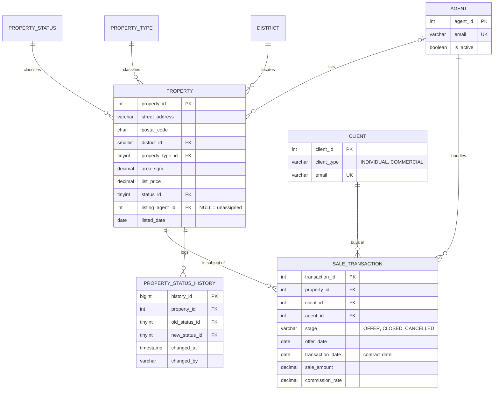

# Berealty: Real Estate Process Transformation and RDBMS

**Moving a Berlin estate agency from linked spreadsheets to a governed MySQL database: 3NF data model, ten business rules enforced by triggers, and the reports management actually uses.**


This is the production-grade rebuild of my M.Sc. Data Analytics coursework (BSBI Berlin, module *Enterprise Data Warehouses and Database Management Systems*, October 2024). Berealty is the fictional agency from the assignment brief. See [What changed from the coursework](#what-changed-from-the-coursework).

---

## The business problem

Berealty ran on separate spreadsheets for listings, clients, agents and deals. That set-up had four recurring failures:

| Failure in the spreadsheet process | Consequence | Fix in this database |
|---|---|---|
| A deal closed in one file, the listing marked "Sold" in another, by hand | Sold properties still shown as available; two agents working the same property | Status is **derived from deals by triggers** (rule R1); manual SOLD is impossible (R9) |
| Agent and client details copied into every deal row | Same person spelled three ways; contact changes missed | Each fact stored once (3NF); deals hold only keys |
| Nothing stops a typo | An extra digit turns EUR 812,895 into EUR 8,128,953 | CHECK constraints plus a plausibility rule (R6) |
| Status changes overwrite the cell | No answer to "when did this go under offer, and who changed it?" | Append-only history written by triggers (R10) |

The design goal is the one I apply in process transformation work: **make the right action the only possible action**, so the control runs on every transaction, not on a monthly check.

## Data model



### Cardinalities

| Relationship | Cardinality | Participation |
|---|---|---|
| Property status / type / district to property | 1 : N | Every property has exactly one of each |
| Agent to property (listing agent) | 0..1 : N | A listing may be unassigned until a team lead allocates it |
| Property to sale transaction | 1 : N | Offers can fail and be followed by another; **at most one** closed sale per property (unique index on a generated column) |
| Client / agent to sale transaction | 1 : N | Every deal has one buyer and one responsible agent |
| Property to status history | 1 : N | One row per status change, written only by triggers |

### Normalisation, 1NF to 3NF

| Step | Rule | What it changed here |
|---|---|---|
| **1NF** | Atomic values, no repeating groups | "Contact info" split into `email` and `phone`; names into first and last name; one deal per row instead of several deals in one cell |
| **2NF** | Every non-key column depends on the whole key | Single-column surrogate keys throughout, so no partial dependencies can exist |
| **3NF** | No non-key column depends on another non-key column | Status, property type and district moved to lookup tables. Agent and client details live only in their own tables. **The status is not stored on the deal**: it is a fact about the property, derived from the deal's `stage` |

### Data-governance choices

- **Referential actions are deliberate.** Lookups and financial records use `ON DELETE RESTRICT`: a status in use or an agent with deals cannot be deleted. Removing an agent's master record would set their open listings to unassigned (`SET NULL`), not delete them.
- **Constraints carry the rules, named so errors are readable**: positive prices and areas, five-digit postal codes, valid email shape, a closed deal must have a contract date on or after its offer date, a commercial client must have a company name.
- **Money is `DECIMAL(12,2)`**, dates are `DATE`. (The coursework stored both as text.)
- **Indexes follow the access paths** of the reports and triggers: `(status_id, district_id, list_price)` for inventory screens, `(stage, transaction_date)` for revenue by period, `(agent_id, transaction_date)` for agent performance, `(property_id, stage)` for trigger look-ups.

## Automation and workflow controls

`sql/04_triggers_and_automation.sql` turns the agency's operating rules into database rules. Each rule has a test in `tests/run_tests.sh`.

| Rule | What the database does |
|---|---|
| **R1** | Recording an offer sets the property to UNDER_OFFER; closing sets SOLD; cancelling the only open offer sets it back to AVAILABLE |
| **R2** | A sold or withdrawn property rejects new offers |
| **R3** | One open offer per property at a time |
| **R4** | Agents who have left cannot take new deals |
| **R5** | An offer cannot predate the listing |
| **R6** | The amount must be within 50% to 150% of the list price (catches an extra or missing digit) |
| **R7** | CLOSED and CANCELLED are final; a deal cannot be moved to another property |
| **R8** | Deals are never deleted, only cancelled, so the audit trail survives |
| **R9** | Nobody can set SOLD or UNDER_OFFER by hand; manual changes are limited to AVAILABLE and WITHDRAWN |
| **R10** | Every status change is logged with time and database user |

How the flow looks in practice:

```sql
-- Agent records an accepted offer. Nothing else to update.
INSERT INTO sale_transaction (property_id, client_id, agent_id, offer_date, sale_amount)
VALUES (118, 205, 304, '2025-10-30', 509000);
-- property 118 is now UNDER_OFFER, and the history has a new row

-- Notary appointment done: close the deal. The contract date defaults to today.
UPDATE sale_transaction SET stage = 'CLOSED' WHERE property_id = 118 AND stage = 'OFFER';
-- property 118 is now SOLD; a second sale of 118 is impossible

-- A typo is stopped at source:
INSERT INTO sale_transaction (property_id, client_id, agent_id, offer_date, sale_amount)
VALUES (119, 206, 304, '2025-10-30', 9270000);
-- ERROR 1644 (45000): Amount 9270000.00 is outside 50%-150% of the list price 927000.00.
--                     Check the figure or update the list price first.
```

Errors are raised with `SQLSTATE '45000'` and a message that tells the user what to do next, so a front end can show them as they are.

## Reports

`sql/03_business_queries.sql` holds eight queries, each headed by the business question it answers and who uses it.

| # | Question | Techniques |
|---|---|---|
| Q1 | Agent league table: revenue, share of total, sale-to-list ratio, commission, open pipeline | CTEs, `RANK()`, `SUM() OVER ()` |
| Q2 | Monthly revenue with year-to-date running total and month-on-month change, months without sales included | Recursive CTE calendar, `SUM() OVER (PARTITION BY ... ORDER BY ...)`, `LAG()` |
| Q3 | Quarterly and yearly revenue, residential vs commercial, with subtotals | `GROUP BY ... WITH ROLLUP`, `GROUPING()` |
| Q4 | Days a listing spends available and under offer, by property type | `LEAD()` over the status history |
| Q5 | Exception queue: unassigned listings and listings without an offer for 90+ days, each with an action | `LEFT JOIN` to an aggregate, rule-based `CASE` |
| Q6 | Most valuable and repeat buyers, with their latest purchase | `ROW_NUMBER()`, `DENSE_RANK()` |
| Q7 | Stock, value and achieved vs asking EUR/m² by district | Conditional aggregation (pivot), `CROSS JOIN` |
| Q8 | Governance control that must return zero rows: status vs deals, implausible amounts, deals held by leavers | `UNION ALL` of rule checks, `EXISTS` / `NOT EXISTS` |

Sample output of Q1 on the included data (2025 year to 31 October):

| Rank | Agent | Deals closed | Revenue (EUR) | Share | Sale-to-list | Open offers |
|---|---|---|---|---|---|---|
| 1 | Tobias Wagner | 4 | 2,752,200 | 53.9% | 99.0% | 2 |
| 2 | Markus Schulz | 1 | 703,700 | 13.8% | 105.3% | 1 |
| 3 | Jonas Becker | 1 | 698,000 | 13.7% | 95.0% | 0 |

## Distributed design and the CAP theorem

If Berealty grows to offices in several cities with database nodes in more than one region, a network partition between regions will happen sooner or later. The CAP theorem says that during a partition the system must choose between **consistency** (every read sees the latest write) and **availability** (every request gets an answer). The right choice differs by workload, so the design splits them:

| Workload | Choice during a partition | Why | How |
|---|---|---|---|
| **Deals and property status** (offers, closings, status changes) | **Consistency (CP)** | Selling the same flat twice is a legal and financial failure. Refusing a write for a few minutes is the cheaper outcome | One primary for writes, synchronous replication (MySQL Group Replication, single-primary mode). A region cut off from the majority becomes read-only |
| **Listing search and portfolio browsing** | **Availability (AP)** | A buyer seeing a price a few seconds old is harmless; a search page that does not load costs leads | Read replicas or a search cache in each region, updated asynchronously. Pages show "status as of" time |
| **Reports (Q1 to Q7)** | Neither is critical | Monthly figures tolerate minutes of lag | Run on a replica or the warehouse, never on the primary |

The rules in this repository are what make that split safe: because R1 to R3 run inside the primary's transaction, a double sale cannot be written even when replicas are briefly behind. The coursework concluded that a real estate system should favour availability over consistency across the board; the rebuild keeps availability for reads but treats consistency of deals as non-negotiable.

## How to run

### Option A: Docker (nothing to install but Docker)

```bash
git clone https://github.com/pankaj-chaubay/berealty-real-estate-rdbms.git
cd berealty-real-estate-rdbms
docker run -d --name berealty-db -e MYSQL_ROOT_PASSWORD=berealty -p 3306:3306 mysql:8.0
# wait about 20 seconds for MySQL to start, then:
for f in sql/01_schema_creation.sql sql/02_sample_data.sql sql/04_triggers_and_automation.sql; do
  docker exec -i berealty-db mysql -uroot -pberealty < "$f"
done
docker exec -i berealty-db mysql -uroot -pberealty --table < sql/03_business_queries.sql
```

### Option B: an existing MySQL 8.0.16+ server

```bash
mysql -u <user> -p < sql/01_schema_creation.sql
mysql -u <user> -p < sql/02_sample_data.sql
mysql -u <user> -p < sql/04_triggers_and_automation.sql
mysql -u <user> -p --table < sql/03_business_queries.sql
```

Run order is 01, 02, 04, then 03. The sample data represents the state after migrating the spreadsheets, so it loads before the triggers; every change after that goes through them. With binary logging on and a non-admin user, creating the function may require `SET GLOBAL log_bin_trust_function_creators = 1;` or the `SET_USER_ID` privilege.

### Run the tests

```bash
tests/run_tests.sh                                    # default: mysql -uroot
MYSQL="mysql -h 127.0.0.1 -uroot -pberealty" tests/run_tests.sh   # Docker
```

The suite rebuilds the database and runs 37 checks: data consistency, constraints, every trigger rule in its accept and reject case, and every report query. GitHub Actions runs it against MySQL 8.0 on every push.

### Regenerate the sample data

```bash
python scripts/generate_sample_data.py > sql/02_sample_data.sql
```

Seeded and reproducible: 32 Berlin listings in 8 districts, 8 agents (one has left the company), 22 clients (4 companies), 25 deals including cancellations and open offers, and the migrated status history. Prices follow district price levels per square metre. All names are fictitious.

## Repository layout

```
berealty-real-estate-rdbms/
├── README.md
├── LICENSE
├── sql/
│   ├── 01_schema_creation.sql          tables, keys, constraints, indexes
│   ├── 02_sample_data.sql              generated sample data
│   ├── 03_business_queries.sql         eight reporting and control queries
│   └── 04_triggers_and_automation.sql  rules R1 to R10
├── tests/
│   └── run_tests.sh                    37 checks against a live MySQL
├── scripts/
│   └── generate_sample_data.py         reproducible data generator
├── docs/
│   └── coursework_review.md            review of the original submission
└── .github/workflows/ci.yml            MySQL 8.0 service + test run
```

## What changed from the coursework

The original was run in Oracle SQL*Plus with values typed in through substitution prompts. A full review is in [docs/coursework_review.md](docs/coursework_review.md). The main changes:

| Coursework | This repository |
|---|---|
| `ON DELETE CASCADE` from status to property: deleting a status deleted every property with it, and their deals | `RESTRICT` on lookups and financial records; `SET NULL` only for listing agents |
| Status copied onto the transaction table, so property and deal could disagree (property 101 was "Available" with a "Sold" deal) | Status derived from deal stage by triggers; a governance query checks it stays that way |
| Dates and amounts stored as text; `Type` declared as a number but holding "Condo" | `DATE`, `DECIMAL(12,2)`, and a property-type lookup table |
| No primary keys on client and agent at creation; no `UNIQUE` or `CHECK` constraints | Keys on every table, unique emails, named CHECK constraints |
| One trigger, run by updating a status column on the deal | Ten rules with validation and readable errors, each tested |
| Four queries, all simple joins | Eight queries with CTEs, recursive CTEs, window functions and ROLLUP, each tied to a business question |
| CAP: favour availability, put consistency "on the back burner" | Consistency for deals, availability for search, explained per workload |

## Author

**Pankaj Chaubay**, Process Transformation Manager (BI and Data Governance), Lean Six Sigma Black Belt, M.Sc. Data Analytics. Munich, Germany.
[LinkedIn](https://www.linkedin.com/in/pankaj-chaubay) · [GitHub](https://github.com/pankaj-chaubay)

## License

MIT.
